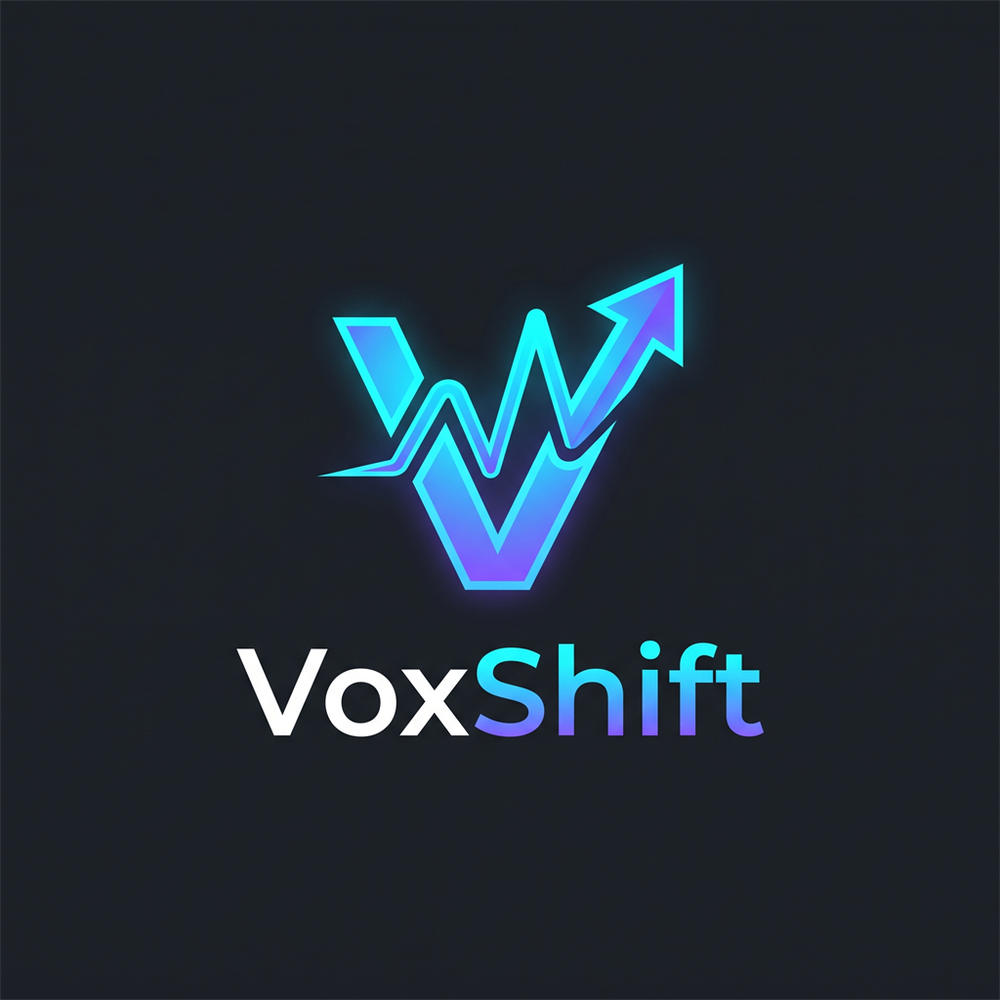
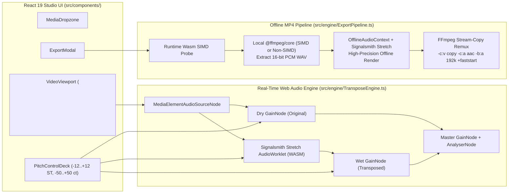

<div align="center">
  

  # VoxShift

  **Real-Time Karaoke Video Pitch Shifter & Offline MP4 Studio**

  [](https://github.com/O144p/voxshift/actions/workflows/ci.yml)
  [](./LICENSE)
  [](https://react.dev/)
  [](https://www.typescriptlang.org/)
  [](https://vite.dev/)
  [](https://developer.mozilla.org/en-US/docs/Web/API/Web_Audio_API)
  [](https://webassembly.org/)
  [](https://www.electronjs.org/)
  [](https://capacitorjs.com/)
</div>

---

## Overview

**VoxShift** (`com.voxshift.app`) is an open-source, studio-grade karaoke key changer and offline MP4 export suite built for singers, vocal coaches, and live karaoke hosts.

Load any local `.mp4` karaoke video (or `.mp3`, `.wav`, `.m4a` backing track), transpose the musical key live from **-12 to +12 semitones** with **-50 to +50 cents** micro-tuning, compare the **Original** and **Modified** keys instantaneously with a glitch-free A/B crossfader, and export a transposed `.mp4` in seconds using lossless video stream copying (`-c:v copy`).

---

## Feature Highlights

- **Zero-Drift `<video>` Master Clock**: Native HTML5 `<video>` drives video playback and on-screen karaoke lyrics while routing audio through Web Audio (`createMediaElementSource`), guaranteeing lyrics never drift from the music.
- **Polyphonic WASM AudioWorklet DSP (`signalsmith-stretch`)**: Real-time polyphonic pitch shifting on a dedicated audio thread without changing playback speed or video duration.
- **Vocal Formant Preservation**: One-click formant compensation prevents unnatural vocal timbre shifts when transposing backing harmonies across several semitones.
- **Glitch-Free A/B Key Comparison**: Smooth exponential Web Audio gain crossfading (`15ms` time constant) switches between **Original** (dry) and **Modified** (transposed) signal paths without clicks or dropouts.
- **Lossless-Video Offline MP4 Export (`-c:v copy`)**: Renders maximum-quality offline audio via `OfflineAudioContext` (`120ms` STFT windows) and remuxes the original H.264/H.265 video stream via `@ffmpeg/ffmpeg` without re-encoding video frames.
- **Automatic Non-SIMD CPU Fallback**: Detects WebAssembly SIMD (`v128`) support at runtime via `WebAssembly.validate(...)` and automatically falls back to a bundled non-SIMD core (`public/ffmpeg-nosimd/`) and V8 SSSE3/interpreter execution on older Windows PCs.
- **Cross-Platform Desktop & Mobile Ready**:
  - **Web / PWA**: Runs 100% client-side with zero server uploads.
  - **Windows Desktop (Electron + NSIS)**: Standalone installer (`VoxShift-Setup.exe`) and unpacked desktop build served over a privileged `app://` origin with strict `COOP` / `COEP` / `CORP` headers.
  - **Android (Capacitor)**: Touch-friendly responsive studio layout, automatic Screen Wake Lock (`navigator.wakeLock`) while singing, and native Android file save/share sheets (`@capacitor/filesystem` + `@capacitor/share`).

---

## Local WASM & FFmpeg Architecture



### Architectural Principles
1. **Strict Engine / UI Decoupling**: All Web Audio routing, `AudioWorklet` scheduling, and `FFmpeg` virtual filesystem operations live in `src/engine/` (`TransposeEngine.ts` and `ExportPipeline.ts`), completely independent of React components in `src/components/`.
2. **100% Local Bundled WASM Assets**: Both `signalsmith-stretch` and `@ffmpeg/core` (`ffmpeg-core.js` and `ffmpeg-core.wasm`) are bundled locally rather than fetched from external CDNs (`unpkg.com` / `jsdelivr.net`), ensuring offline operation and full compliance with `Cross-Origin-Embedder-Policy: require-corp`.
3. **Privileged Electron `app://` Scheme**: `electron/main.cjs` registers `app://` via `protocol.registerSchemesAsPrivileged` and serves every `.html`, `.js`, `.wasm`, and `.css` response with explicit `Cross-Origin-Opener-Policy: same-origin`, `Cross-Origin-Embedder-Policy: require-corp`, `Cross-Origin-Resource-Policy: same-origin`, and accurate `Content-Type` headers (`application/wasm`, `application/javascript`).

---

## Build & Development Instructions

### Prerequisites
- **Node.js** 20+ (Node 22 LTS recommended)
- **npm** 10+

### 1. Web Development & Production Build

```bash
# Install dependencies
npm install

# Start Vite development server with COOP/COEP/CORP isolation headers
npm run dev

# Run linter (oxlint)
npm run lint

# Type-check and build production web bundle into dist/
npm run build
```

### 2. Windows Desktop Application (Electron)

```bash
# Launch Electron desktop window against the local Vite dev server
npm run electron:dev

# Build production web bundle and package Windows NSIS installer + unpacked app
npm run electron:build
```

Outputs in `release/`:
- `release/VoxShift-Setup.exe`: Windows NSIS installer (`oneClick: false`, user-selectable installation directory, Desktop & Start Menu shortcuts).
- `release/win-unpacked/`: Unpacked Windows application for instant startup without extraction overhead.

### 3. Android Packaging (Capacitor)

```bash
# Generate adaptive Android launcher icons & splash screens from assets/icon.png
npx capacitor-assets generate --android --iconBackgroundColor "#07090e" --splashBackgroundColor "#07090e"

# Build production web bundle and sync with Android project
npm run build
npx cap sync android

# Open the Android project in Android Studio
npx cap open android
```

---

## Keyboard Shortcuts

| Shortcut | Action |
| :--- | :--- |
| <kbd>↑</kbd> / <kbd>↓</kbd> | Transpose pitch **+1 / -1 semitone** |
| <kbd>B</kbd> | Toggle **Original / Modified** A/B bypass |
| <kbd>0</kbd> | Reset pitch to **0 semitones / 0 cents** |
| <kbd>Esc</kbd> | Close the MP4 Export modal |

---

## Author & Credits

- **Author**: [Oussama144p (O144p)](https://github.com/O144p) — [github.com/O144p/voxshift](https://github.com/O144p/voxshift)
- **DSP & Media Libraries**:
  - [`signalsmith-stretch`](https://www.npmjs.com/package/signalsmith-stretch) — Polyphonic WebAssembly AudioWorklet time-stretch & pitch-shift DSP
  - [`@ffmpeg/ffmpeg`](https://www.npmjs.com/package/@ffmpeg/ffmpeg) & [`@ffmpeg/core`](https://www.npmjs.com/package/@ffmpeg/core) — Client-side WebAssembly media demuxing & lossless stream-copy MP4 muxing

---

## License

Distributed under the [MIT License](./LICENSE). Copyright (c) 2026 [Oussama144p](https://github.com/O144p).
